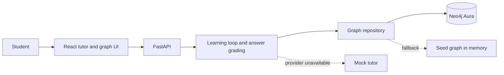

# MindMesh

MindMesh is an adaptive learning tutor that maps a learner's question to a concept, diagnoses prerequisite gaps, teaches the missing concept, and recommends what to learn next. A Neo4j concept graph drives prerequisite paths and mastery; a local mock mode keeps the demo usable without external services.

## Project status

The repository includes the graph-driven learning loop, a deterministic rubric grader, an optional OpenAI-compatible tutor, and a React demo. The backend supports a seeded graph in memory and can connect to Neo4j Aura when configured. The frontend starts with local mock data and switches to the API when it is available. Hosting accounts and secrets are intentionally configured outside the repository.

## Architecture



## Repository layout

```text
backend/
  data/concepts.json    Versioned concepts and prerequisite edges
  app/
    ai/                 Tutor provider and mock fallback
    api/                Graph and learning routes
    graph/              Database helper, parameterized queries, mastery, repository
    models/             Shared API schemas
    main.py             FastAPI application
  scripts/seed.py       Seed the Neo4j concept graph
  tests/                API, graph, and learning-loop tests
frontend/
  src/
    api/                API client with mock fallback
    components/         Shared graph and status components
    pages/              Workspace, graph, tutor, quiz, progress
    types/              API contracts
docs/
  api-contract.md
  graph-schema.md
  demo-script.md
```

## Requirements

- Python 3.11+
- Node.js 20+
- Neo4j Aura database for persistent graph and attempt data (optional for local mock mode)

## Run locally

### Backend

```bash
cd backend
python -m venv .venv
# Windows: .venv\Scripts\Activate.ps1
# macOS/Linux: source .venv/bin/activate
pip install -r requirements.txt
copy .env.example .env  # Windows PowerShell: Copy-Item .env.example .env
uvicorn app.main:app --reload
```

The API runs at `http://localhost:8000`; interactive API docs are at `/docs`. Without Neo4j credentials, it uses the built-in seed graph and in-memory attempts.

### Frontend

```bash
cd frontend
npm install
copy .env.example .env  # Windows PowerShell: Copy-Item .env.example .env
npm run dev
```

Open the Vite URL shown in the terminal. If the backend is unavailable, the frontend shows the seeded mock learning flow. Set `VITE_API_BASE_URL=http://localhost:8000` to use the API.

### Seed Neo4j Aura

Set `NEO4J_URI`, `NEO4J_USERNAME`, and `NEO4J_PASSWORD` in `backend/.env`, then run:

```bash
cd backend
python scripts/seed.py
```

The seed script is idempotent: it merges concept nodes and prerequisite edges by stable IDs.

## Learning flow

1. The learner enters a question or chooses a target concept.
2. MindMesh maps the question to a concept. Low-confidence matches ask the learner to choose a topic.
3. The API returns the prerequisite graph and a diagnostic question.
4. The learner's answer is graded against the concept rubric and saved as an attempt.
5. The response includes the score, feedback, matched rubric points, and missing rubric points. The graph updates mastery and recommends the nearest unmet prerequisite; after a successful retest it can recommend the original target.
6. Teaching material comes from the configured tutor provider when it returns valid content; missing credentials, invalid responses, timeouts, and provider errors use the authored local explanation and worked example.

Mastery states are `unknown`, `needs_review`, and `demonstrated`. No attempts means `unknown`; a latest score below 0.5 means `needs_review`; otherwise the mean of the latest two scores is compared with the default 0.7 threshold (`MASTERY_THRESHOLD`). The graph response explains why a prerequisite is next in `next_reason`.

## Graph and seed data

The source data in `backend/data/concepts.json` contains 15 concepts and 18 `REQUIRES` edges. An edge from A to B means A is a prerequisite for B. Each concept includes an original explanation, diagnostic question, worked example, and rubric. The Aura seed command creates uniqueness constraints and uses parameterized `MERGE` statements, so it is safe to run repeatedly. `docs/graph-schema.md` describes the node model, mastery rule, and recommendation behavior.

`GET /api/graph/{concept_id}?student_id=...` returns `{nodes, edges, target, next_concept, next_reason}`. It picks the closest unmet prerequisite whose own prerequisites are demonstrated, and returns a readable reason that Person 3 can display in the graph UI.

## API

See [the API contract](docs/api-contract.md). Main routes:

- `GET /api/health`
- `GET /api/concepts`
- `GET /api/graph/{concept_id}`
- `POST /api/learning/start`
- `POST /api/diagnose`
- `POST /api/answer`
- `POST /api/learning/next`
- `POST /api/mastery/update`

## Configuration and secrets

Copy the relevant `.env.example` files to `.env` for local development. Never commit `.env` files or real Neo4j/LLM credentials. Configure those values in GitHub Actions and the hosting provider's secret/environment settings.

## Deploy

- Frontend: import `frontend/` into Vercel; set `VITE_API_BASE_URL` to the deployed API URL.
- Backend: deploy `backend/` using the included Dockerfile or `render.yaml`; set `NEO4J_URI`, `NEO4J_USERNAME`, `NEO4J_PASSWORD`, and `CORS_ORIGINS` as environment values.
- Provision Neo4j Aura separately and run the seed script once against the target database.

The repo does not contain live deployment URLs yet. Add them here after the team deploys the app.

## Team workflow

Use short-lived `feat/...`, `fix/...`, and `chore/...` branches. Keep pull requests focused, update `docs/api-contract.md` when shared request/response shapes change, and review changes to the API contract with the whole team. Keep `main` deployable and require CI and review through repository branch protection settings.

See [the demo script](docs/demo-script.md) for the two-minute walkthrough and fallback steps.
